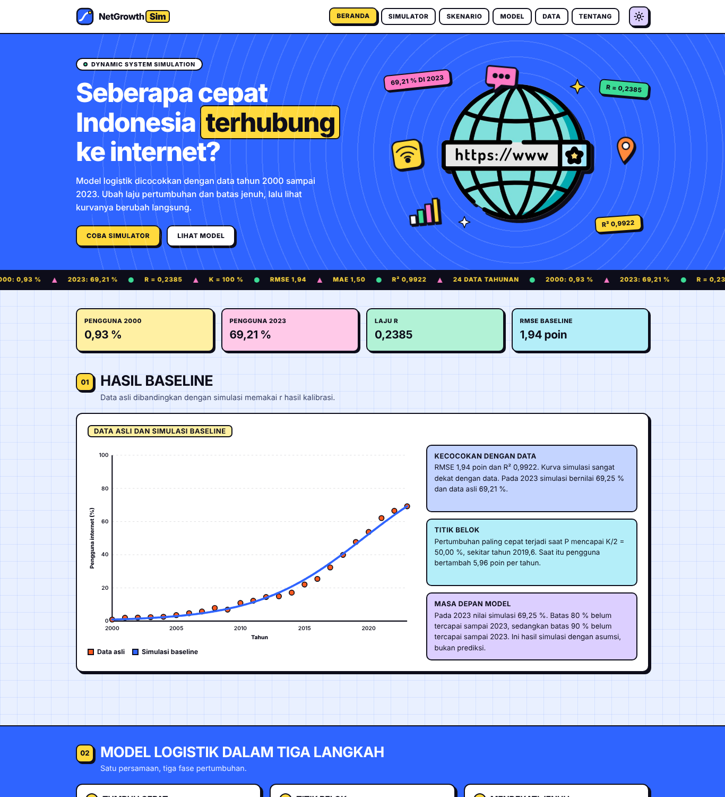
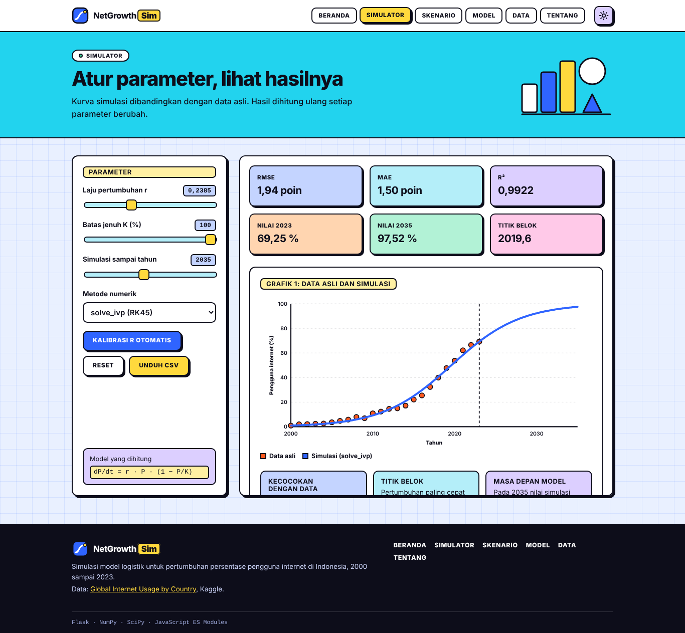
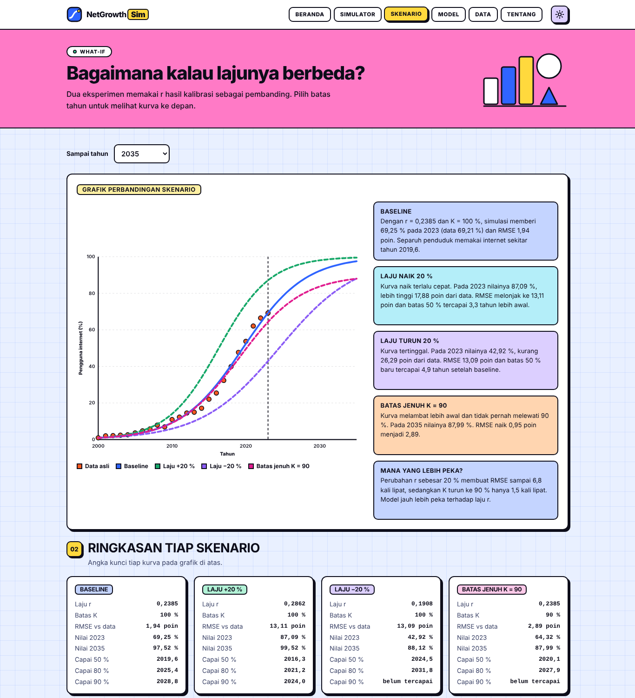
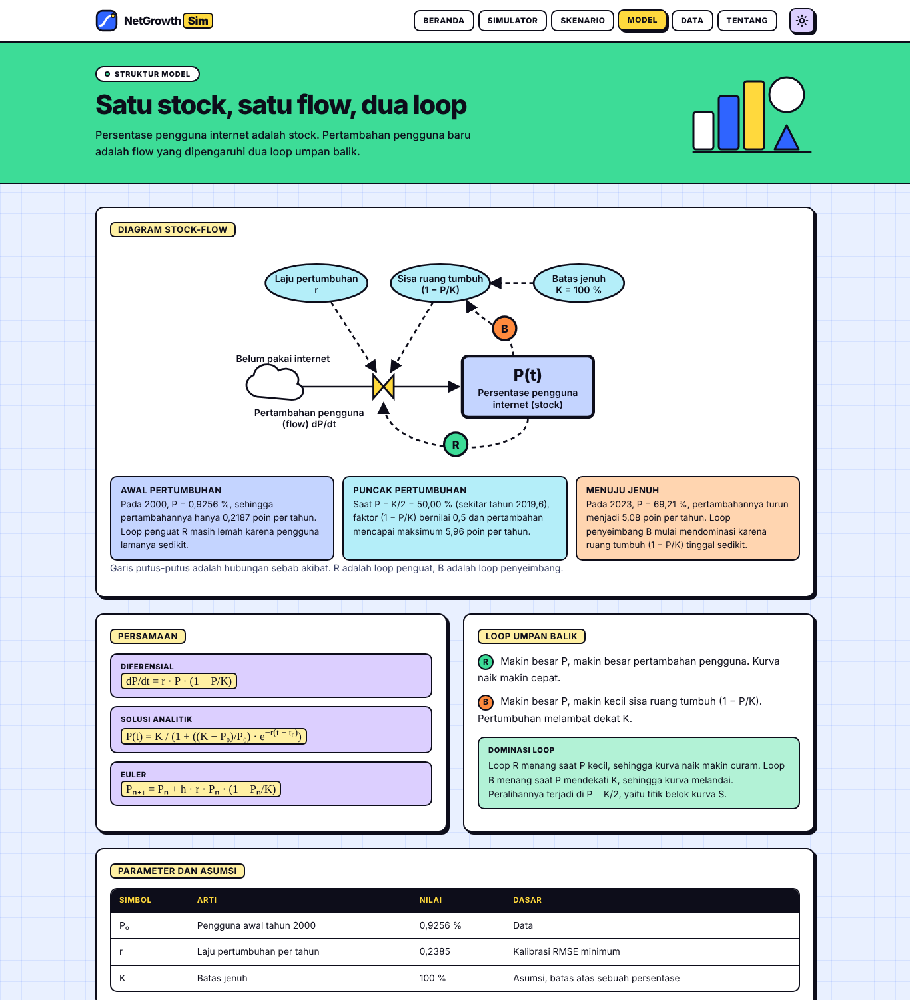
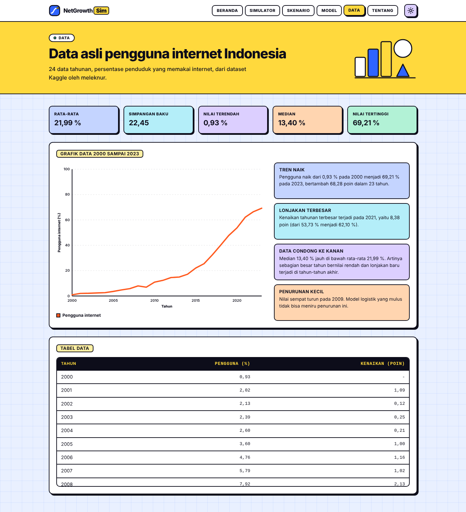
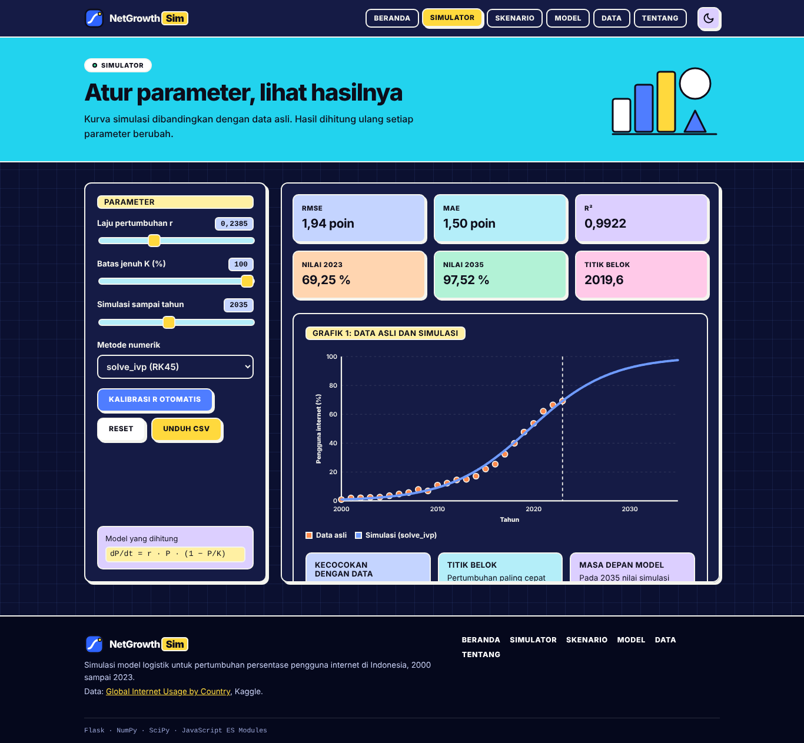

# NetGrowthSim - Simulasi Pertumbuhan Pengguna Internet di Indonesia


Aplikasi web berbasis Flask untuk mensimulasikan pertumbuhan **persentase pengguna internet di Indonesia tahun 2000 sampai 2023** dengan **model logistik** (sistem dinamik). Pengguna bisa mengubah laju pertumbuhan dan batas jenuh, memilih metode numerik, lalu melihat kurva simulasi dibandingkan dengan data asli, dengan tampilan **Neobrutalism** dan halaman yang terpisah. Setiap grafik punya penjelasan yang dihitung dari angka hasilnya.

Notebook analisis yang mendasari model ada di folder `notebook/`.

---

## Fitur Aplikasi

- **Enam halaman terpisah** - Beranda, Simulator, Skenario, Model, Data, dan Tentang
- **Ekspor CSV** - hasil simulasi bisa diunduh dari halaman Simulator
- **Simulator interaktif** - atur laju pertumbuhan `r`, batas jenuh `K`, tahun akhir simulasi, dan metode numerik. Grafik dan metrik dihitung ulang setiap parameter berubah
- **Tiga metode numerik** - `solve_ivp` (RK45), Euler dengan langkah `h` yang bisa diatur, dan solusi analitik
- **Kalibrasi otomatis** - tombol untuk mencari `r` dengan RMSE terkecil terhadap data pada `K` yang dipilih
- **Ukuran kecocokan** - RMSE, MAE, dan R² terhadap data asli
- **Penjelasan per grafik** - setiap grafik punya kartu penjelasan yang dihitung dari angka hasilnya dan ikut berubah saat parameter diubah, termasuk titik belok, capaian 80 % dan 90 %, serta peringatan bila `K` terlalu rendah atau langkah Euler terlalu besar
- **Skenario What-If** - laju +20 %, laju −20 %, dan batas jenuh K = 90 dibandingkan dengan baseline, plus tabel kepekaan terhadap `K`
- **Struktur model** - diagram Stock-Flow, persamaan, loop umpan balik, dan asumsi
- **Data asli** - grafik, statistik ringkas, dan tabel kenaikan tahunan
- **Tema terang dan gelap** - tema terang menjadi bawaan, tombol matahari dan bulan untuk berganti. Tampilan menyesuaikan desktop dan mobile

---

## Teknologi

| Komponen | Teknologi |
|---|---|
| Backend | Flask 3.1 (rute halaman, REST API JSON, halaman 404) |
| Perhitungan | NumPy dan SciPy (`solve_ivp`, `minimize_scalar`) |
| Frontend | HTML (Jinja2), CSS, JavaScript ES Modules |
| Grafik dan diagram | SVG yang digambar dengan JavaScript |
| Font | Font sistem (tanpa unduhan tambahan) |
| Desain | Neobrutalism: garis tebal, bayangan keras, warna pastel dengan biru sebagai warna utama |

---

## Model yang Dipakai

```
dP/dt = r · P · (1 − P/K)
P(t)  = K / (1 + ((K − P₀)/P₀) · e^(−r(t − t₀)))
```

| Simbol | Arti | Nilai |
|---|---|---|
| P₀ | Pengguna awal tahun 2000 | 0,9256 % |
| r | Laju pertumbuhan, hasil kalibrasi RMSE minimum | 0,2385 per tahun |
| K | Batas jenuh, asumsi batas atas sebuah persentase | 100 % |

Hasil baseline dengan `solve_ivp`: RMSE 1,94 poin, MAE 1,50 poin, R² 0,9922.

---

## Sumber Data

Dataset **Global Internet Usage by Country (2000-2023)** oleh meleknur di Kaggle, file `internet_usage.csv`, baris Indonesia (persen penduduk yang memakai internet). Hasil ekstraksinya disimpan di `data/internet_indonesia.csv` (24 baris). Dataset asli: https://www.kaggle.com/datasets/meleknur/global-internet-usage-by-country-2000-2023

---

## Validasi

| Pengujian | Hasil |
|---|---|
| Kalibrasi baseline | r = 0,2385, RMSE 1,9397, R² 0,9922, sama dengan notebook |
| `solve_ivp` dibanding solusi analitik | Selisih terbesar di bawah 0,0001 poin |
| Euler h = 1 dan h = 0,1 | RMSE 5,6761 dan 1,9828, makin kecil h makin teliti |
| Nilai simulasi | Tidak pernah melewati batas jenuh K |
| Masukan tidak valid | Ditolak dengan kode 400 dan pesan yang jelas |

---

## Instalasi Lokal

### 1. Clone repository

```bash
git clone https://github.com/Alnazh/ta07-simulasi-internet-indonesia.git
cd ta07-simulasi-internet-indonesia
```

### 2. Buat virtual environment

```bash
python -m venv venv

# Windows (PowerShell, jika muncul error execution policy:
# Set-ExecutionPolicy -Scope Process Bypass)
venv\Scripts\activate

# Linux / macOS
source venv/bin/activate
```

### 3. Install dependencies

```bash
pip install -r requirements.txt
```

### 4. Jalankan aplikasi

```bash
python app.py
```

Buka browser di `http://127.0.0.1:5000`

### 5. Jalankan tes (opsional)

```bash
python -m unittest discover tests
```

---

## Struktur Project

```
ta07-simulasi-internet-indonesia/
├── app.py                      # Entry point Flask, rute halaman, dan API
├── requirements.txt            # Daftar dependensi Python
├── Procfile                    # Konfigurasi server produksi
├── .gitignore
│
├── simulation/                 # Mesin simulasi (Python)
│   ├── model.py                # Model logistik, Euler, solve_ivp, kalibrasi
│   ├── scenarios.py            # Skenario What-If dan kepekaan K
│   ├── insights.py             # Teks penjelasan dari angka hasil
│   ├── data.py                 # Pembaca data dan statistik
│   └── errors.py               # Galat validasi
│
├── data/
│   └── internet_indonesia.csv  # Data Indonesia 2000-2023
│
├── notebook/
│   └── TA07_Simulasi_Pengguna_Internet_Indonesia.ipynb
│
├── templates/                  # HTML (Jinja2)
│   ├── base.html               # Kerangka: navbar, tema, footer
│   ├── beranda.html
│   ├── simulator.html
│   ├── skenario.html
│   ├── model.html
│   ├── data.html
│   └── tentang.html
│
├── static/
│   ├── css/                    # tokens, base, components
│   └── js/                     # Modul JavaScript per halaman
│       ├── main.js             # Pemuat modul sesuai halaman
│       ├── chart.js            # Penggambar grafik SVG
│       └── beranda.js, simulator.js, skenario.js, data.js
│
├── tests/
│   └── test_app.py             # Unit test model dan API
│
└── docs/
    └── screenshots/            # Tangkapan layar aplikasi
```

---

## Tampilan Aplikasi

### Beranda


### Simulator


### Skenario What-If


### Struktur Model


### Data


### Tema Gelap


---

## Cara Penggunaan

1. Buka halaman **Simulator**, lalu geser parameter `r`, `K`, dan tahun akhir
2. Pilih metode numerik. Untuk Euler, atur langkah `h`
3. Klik **Kalibrasi r otomatis** untuk mencari `r` terbaik pada `K` yang dipilih
4. Baca kartu penjelasan di bawah tiap grafik, angkanya berubah sesuai hasil
5. Buka halaman **Skenario** untuk membandingkan laju dan batas jenuh yang berbeda
6. Buka halaman **Model** untuk melihat diagram Stock-Flow dan persamaannya

---

## Keterbatasan

- `K = 100 %` adalah asumsi karena data belum menunjukkan tanda jenuh
- Laju `r` dianggap konstan, padahal data punya periode lonjakan 2013 sampai 2018
- Penurunan kecil pada 2009 tidak bisa dijelaskan model logistik
- Hasil bergantung pada satu dataset dan definisi pengguna internet di dalamnya
- Nilai setelah 2023 adalah hasil simulasi dengan asumsi, bukan prediksi

---

## Kredit

- Ilustrasi bumi di beranda: ikon gratis dari Magnific (Flaticon). Cantumkan atribusi sesuai lisensinya bila aplikasi dipublikasikan
